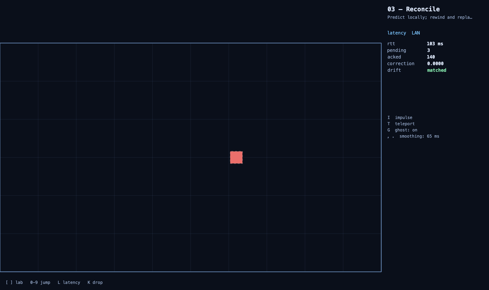
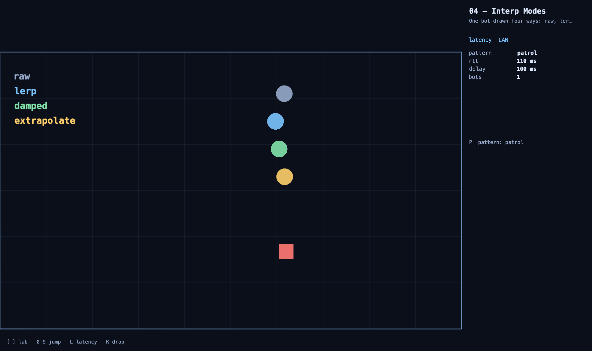

# Prediction Playground — Swift

The playground on the [Colyseus Swift SDK](../../../../native-sdk/platforms/swift),
which is Swift over the native C SDK. Renders with SpriteKit on macOS.



## Run it

Three things, in order.

**1. The playground server** — it serves the web client and the Colyseus rooms
from one port:

```sh
cd demos/prediction-tools
pnpm install
pnpm dev --host 0.0.0.0
```

`--host` is not optional. Without it Vite binds IPv6 loopback only, and a
native client connecting to `127.0.0.1` gets nothing.

**2. The native library** (needs [Zig](https://ziglang.org) 0.15.2):

```sh
cd native-sdk/platforms/swift
./build.sh
```

**3. The app:**

```sh
cd demos/prediction-tools/clients/swift-app
swift run playground
```

Point it elsewhere with `--endpoint ws://host:port`, or `PLAYGROUND_ENDPOINT`.

## Controls

| Key | |
|---|---|
| `WASD` / arrows | move |
| `0`–`9` | jump to a lab |
| `[` / `]` | step through all twelve |
| `L` | cycle injected latency |
| `K` | drop the connection |
| mouse / click | aim and fire (labs 06, 09, 11) |

Everything else is per-lab and listed in the right-hand panel.

### Injected latency

Localhost has none, so most of these labs show nothing at the default preset.
The SDK injects it at the transport seam, which is the honest place: everything
above — decoding, prediction, reconciliation — behaves exactly as it would on a
real connection. `L` cycles 0 / 80 / 200 / 200+80 jitter / 400 ms, each a
**round trip**.

## Labs

| | | |
|---|---|---|
| 00 | Lag vs Prediction | The same entity drawn twice: as it arrives, and as predicted. |
| 01 | Feel the Lag | The server's position, drawn directly — every keypress waits a round trip. |
| 02 | Clocks | Local time, estimated server time, and the slew-limited render timeline. |
| 03 | Reconcile | Predict locally; rewind and replay when the server disagrees. |
| 04 | Interp Modes | One bot drawn four ways at once. |
| 05 | Dead Reckoning | Forward-simulate the last snapshot instead of interpolating it. |
| 06 | Lag Compensation | Shoot at where you see a bot; the server rewinds to that instant. |
| 07 | WYSIWYG | Judge a collision at the instant the input was stamped, and freeze the verdict. |
| 08 | Optimistic Events | Show the goal when you predict it; confirm or retract when the server rules. |
| 09 | Predicted Spawns | Fire immediately, then hand off to the server's projectile with no seam. |
| 10 | Composite Sim | A paddle and a puck rolled back together, because one hits the other. |
| 11 | Deterministic RNG | Both sides derive the same shotgun spread from a shared seed. |



In lab 03, your square is the prediction and the dashed ghost is the last
position the server confirmed. Press **I** and the server kicks you in a way
the client never predicted: the correction appears and decays rather than
snapping. `drift` stays `matched` because `Sources/PlaygroundKit/Sim` computes
exactly what the server computes.

Lab 05 is worth setting to `wander`. Patrol, circle and teleport all track
exactly, because the client can compute them; wander re-rolls its heading from
a seed only the server has, so dead reckoning visibly breaks. That is the
honest limit of the technique, not a bug.

## How it fits together

```
SKScene.update(_:)
  └─ playground.frame()
       ├─ Colyseus.pump()        release inbound traffic, decode, deliver events
       └─ lab.frame(now, dt)
            ├─ predict.tick(now) → how many fixed steps this frame
            └─ input.send() × N  each one predicted immediately
  └─ playground.draw()           a DrawList in world units
  └─ paint it
```

Pumping from the frame callback keeps decoding, prediction and drawing on one
thread and inside one frame; the SDK's own timer is turned off in the scene
(`Colyseus.autoPump = false`).

| | |
|---|---|
| `Sources/PlaygroundKit/Sim/` | The server's shared simulation, transliterated. Pinned against the same reference values `clients/native-app/sim.h` uses. |
| `Sources/PlaygroundKit/Gen/` | Typed schema classes, one namespace per room. Regenerate with `npx schema-codegen src/server/schema/move.ts --swift --bundle --namespace LabMove --output clients/swift-app/Sources/PlaygroundKit/Gen` |
| `Sources/PlaygroundKit/Framework/` | The lab contract, the world-to-screen fit, the keyboard, the fixed-step pacer. |
| `Sources/PlaygroundKit/Labs/` | The twelve labs. None of them draw — they fill a `DrawList` in world units and the scene paints it, which is what lets the tests mount all twelve with no window. |
| `Sources/Playground/` | The SpriteKit scene, the panel and the app shell. |

## Checks

```sh
swift run playground --selfcheck   # no server, no display
swift test                          # needs the playground server
```

`--selfcheck` runs the shared simulation against the reference values from the
TypeScript original — the same ones the C port pins, so the two are held to one
standard rather than two. It covers the movement step, the SQRT1_2 diagonal to
the last bit, the bot patterns, the uint32 RNG vectors including a seed above
2³¹, the hitscan ray, and the hockey contacts.

`swift test` then drives the real labs against the real server:

- every lab mounts, joins, runs real frames, reports telemetry and draws;
- the clock syncs to the server;
- reconcile leads the server, corrects to nothing, and an impulse produces a
  correction that decays;
- the two lanes of lab 00 separate under injected latency;
- dead reckoning tracks a computable bot and admits it cannot predict `wander`;
- a predicted goal is confirmed and none are retracted at deny rate zero;
- a predicted spawn is handed off with a measured lead;
- the composite sim stays inside the 0.5 the playground measured as the line
  between a contested touch and a determinism bug;
- the client's shotgun fan matches the server's to less than 1e-12 radians;
- a dropped connection comes back and prediction survives the input sequence
  restarting at zero.

`--screenshot <path> --lab <n>` plays a lab for a few seconds and writes what it
drew, which is where the pictures above come from.

## Known gaps

- macOS only so far. Nothing in `PlaygroundKit` is platform-specific and the
  SDK builds for iOS and tvOS, but the app shell is AppKit.
- The panel shows telemetry as numbers rather than sparklines.
- Lab 04's four modes are stacked vertically rather than shown on a timeline
  strip of samples against outputs.
